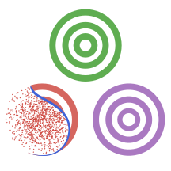

<h1 align="center">
 UncertaintyQuantification.jl
</h1>

| Category | Badges |
|---|---|
| Build status |   |
| Documentation |   |
| Code quality |   |
| References |  |

A Julia package for uncertainty quantification. Current functionality includes:

* Simulation-based reliability analysis
  * Monte Carlo simulation
  * Quasi Monte Carlo simulation (Sobol, Halton)
  * (Advanced) Line Sampling
  * Subset Simulation
  * Propagation of imprecise probabilites
* Sensitivity analysis
  * Gradients
  * Sobol indices
* Metamodeling
  * Polyharmonic splines
  * Response Surface Methodology
  * Radial basis function networks
  * Polynomial Chaos Expansion
  * Gaussian Processes
  * Interval Predictor Models
* Bayesian Updating
* Third-party solvers
  * Connect to any solver by injecting random samples into source files
  * HPC interfacing with slurm
* Stochastic Dynamics
  * Power Spectral Density Estimation
  * Stochastic Process Generation
